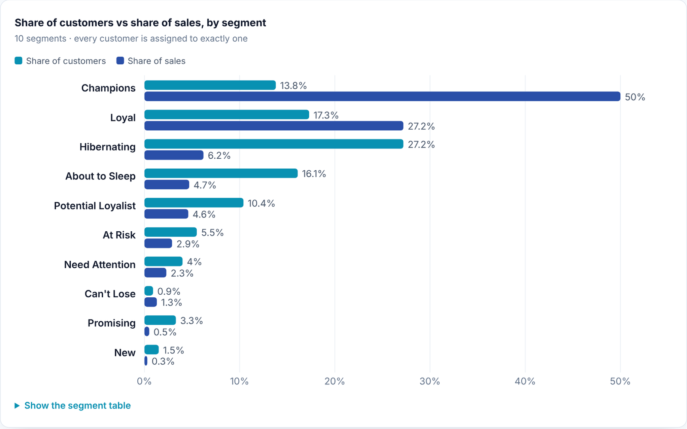
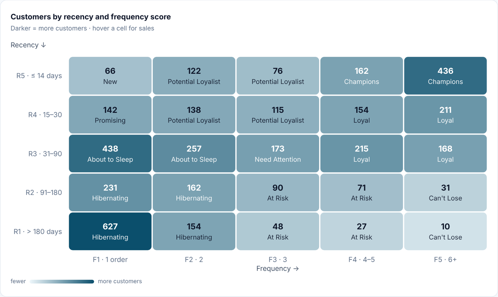
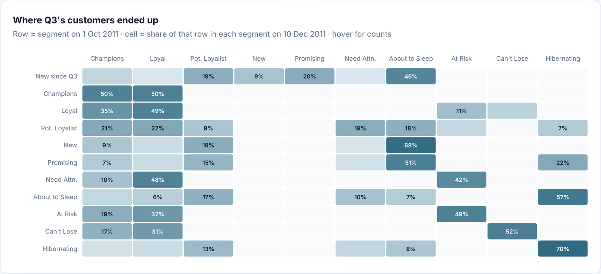
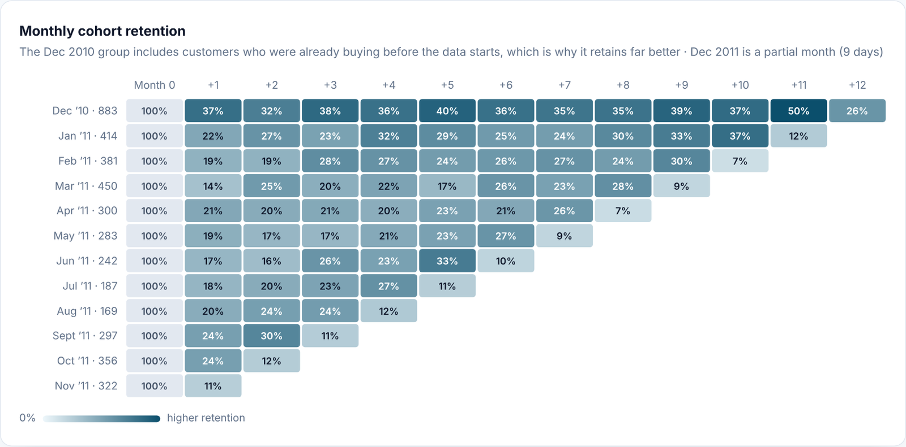

# Customer Segmentation & Retention (RFM in SQL)

**Which customers keep the business running, which ones are slipping away, and where should the next marketing pound go?**

An end-to-end customer analytics project on **541,909 real transactions** from a UK online gift retailer (UCI Online Retail, Dec 2010 – Dec 2011), built as a bronze → silver → gold SQL pipeline.

**[▶ View the interactive report](https://pervejhosen.github.io/projects/customer-segmentation/)**



---

## Key findings

| | Finding |
|---|---|
| **31% → 77%** | Champions and Loyal customers (1,346 people, 31% of the base) bring in **77% of all sales**. |
| **£355k** | of past sales sits with **277 At Risk and Can't Lose** customers: repeat buyers who have not ordered in over 3 months. |
| **46%** | of the 718 customers acquired since October are already "About to Sleep". In 2011, only about **1 in 5 new customers** ordered again the following month. |
| **27% → 6%** | Hibernating customers are 27% of the base but only 6% of sales. |
| **51%** | of Q3's At Risk customers came back as Loyal or Champions during the Q4 peak, so win-back is realistic. |

## Recommendations

1. **Win back the quiet regulars** (At Risk, Can't Lose): personal outreach and reorder reminders from past baskets. Highest value per contact.
2. **Protect the top tier** (Champions, Loyal): loyalty perks and service, not discounts. Half of Q3's Champions had not ordered in the last 14 days by 10 December.
3. **Earn the second order** (New, Promising, Potential Loyalist): a welcome series with a small incentive on order two.
4. **Wake them up before they sleep** (About to Sleep, Need Attention): triggered emails at 30 and 60 days of inactivity.
5. **Keep costs low on the dormant tail** (Hibernating): newsletters and seasonal campaigns only, no paid retargeting.
6. **Measure movement**: rebuild segments monthly and report migration between segments as the KPI.

## What's inside

| Analysis | What it answers |
|---|---|
| RFM scores and 10 segments | Who are the best, newest, fading and lost customers? Every customer is assigned, no "other" bucket. |
| R × F map | How the base is spread across recency and frequency. |
| Quarterly segment migration | Are segments growing or draining? Where did each Q3 segment end up? |
| Monthly cohort retention | Do new customers come back? |
| Monthly trends | Sales and active customers over time. |





## How it was built

```
data/raw/online_retail.csv.gz      541,909 invoice lines (UCI, CC BY 4.0)
        │
sql/01_bronze.sql        BRONZE  raw lines loaded as published
sql/02_silver.sql        SILVER  cleaned and classified
sql/03_gold_rfm.sql      GOLD    one row per customer + R, F, M scores and segment
sql/04_gold_summary.sql          segment summary, R × F grid, monthly trend
sql/05_gold_migration.sql        quarterly snapshots and segment migration
sql/06_gold_cohorts.sql          monthly acquisition cohorts and retention
        │
output/*.csv  +  report/index.html (interactive report)
```

### Cleaning rules (silver)

- Removed 5,268 exact duplicate lines
- Dropped lines without a customer ID (they can't be attributed to anyone)
- Separated cancellations (invoices starting with `C`) from purchases
- Removed purchases that were later **cancelled in full** (same customer, product and quantity), together with their cancellations. Otherwise one-off mistakes, such as a £168k order cancelled the same day, inflate both sales and returns.
- Excluded postage, fees, bank charges and manual adjustments (`POST`, `DOT`, `M`, `BANK CHARGES`, `AMAZONFEE` and others)

Result: **387,230 sales lines, 18,247 orders, 4,324 customers, £8.26M in product sales.**

### Scoring rules (gold)

Fixed business thresholds instead of quantiles, so a score means the same thing at every snapshot and the 1,500 one-time buyers are never split across scores by an arbitrary tie-break.

| Score | Recency (days since last order) | Frequency (orders) | Monetary (sales, GBP) |
|---|---|---|---|
| 5 | 0–14 | 6+ | 2,000+ |
| 4 | 15–30 | 4–5 | 1,000–1,999 |
| 3 | 31–90 | 3 | 500–999 |
| 2 | 91–180 | 2 | 250–499 |
| 1 | over 180 | 1 | under 250 |

Segments follow the standard R × F grid (for example R 5 + F 4–5 = Champions, R 1–2 + F 5 = Can't Lose). All 25 combinations map to a segment.

### Checks

Segment counts and sales were recomputed independently in pandas (no shared code with the SQL) and match exactly.

## Run it yourself

```bash
pip install -r requirements.txt
python run.py
```

This runs every SQL file in order on DuckDB, writes the gold tables to `output/` and refreshes the report data. Open `report/index.html` to view the report locally. The SQL uses standard window functions and CTEs and ports to Snowflake or BigQuery with minor syntax changes (`DATE_DIFF`, macros as UDFs).

## Data

Daqing Chen, *Online Retail*, UCI Machine Learning Repository, 2015. [https://doi.org/10.24432/C5BW33](https://doi.org/10.24432/C5BW33). Licensed under CC BY 4.0.

---

Built by **[Pervej Hosen](https://pervejhosen.github.io)** · Sr. Power BI Developer & Analytics Engineer
